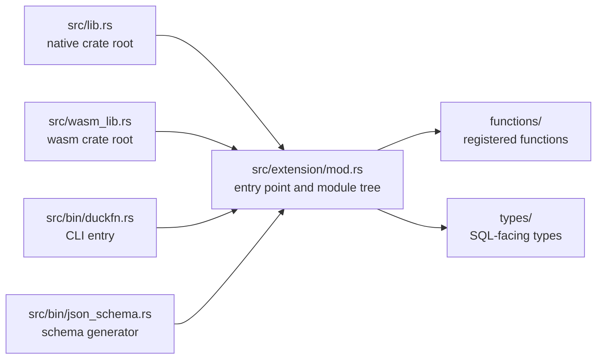

# Project structure

```text
src/lib.rs             native crate root  ->  mod extension;
src/wasm_lib.rs        wasm crate root    ->  mod extension;   (the same mods, mirrored)
src/extension/mod.rs   ->  duckfn_entrypoint!("duckfn_kuva"); + mod functions; mod types;
src/bin/duckfn.rs      duckfn CLI entry   ->  #[path] mod extension; + duckfn::cli::run(...)
src/bin/json_schema.rs JSON Schema generator ->  #[path] mod extension; + schemars
                       (only built with the json-schema feature, see below)

src/extension/functions/
    mod.rs             mod kuva_render; mod kuva_render_terminal; mod kuva_render_file; mod spec;
    kuva_render.rs     kuva_render(json[, data]) -> SVG: the JSON entry point
    kuva_render_terminal.rs  the same spec rendered as terminal text
    kuva_render_file.rs      the same spec written to an SVG file (native builds only)
    spec/mod.rs        render_json: parse the JSON and render it
    spec/schema/       the JSON schema as serde types (panel / style / series)
    spec/schema/series/  one file per chart type — all 64 of kuva's plot types
    spec/convert/      spec -> kuva translation (layout, enums, one build fn per chart)
                       charts/ mirrors spec/schema/series/; every file ends with an inline
                       `#[cfg(test)] mod tests`: JSON in, SVG out, validated as XML
                       (the two shared helpers are in spec/mod.rs)
src/extension/types/
    mod.rs             an empty slot: SQL-facing types go here (none yet)

src/extension/functions/…   the registered functions
test/sql/                   SQLLogicTest files
sdk/json_schema/            the generated JSON Schema of kuva_render's two arguments
sdk/ts/                     the TypeScript SDK package, generated from those schemas
sdk/openapi/                the shared JSON Schema -> OpenAPI 3.1 wrapper (the Java and Kotlin SDKs)
sdk/java/                   the Java SDK, generated from that OpenAPI document (openapi-generator)
sdk/kotlin/                 the Kotlin Multiplatform SDK, generated from it too (ogen)
scripts/rename.sh           rename the extension after cloning
scripts/release.sh          version bump, tag, development version
Justfile                    the everyday commands
docs/                       this documentation site
community-extension/        the community-extension registration draft
```

## The two crate roots

`src/lib.rs` and `src/wasm_lib.rs` both declare exactly one module, `mod extension;`, and
`extension/mod.rs` attaches everything else. The official Rust template instead writes `mod lib;` and
forwards it a second time from the wasm root, which breaks as soon as modules nest
(`error[E0583]: file not found for module …`): there would be two copies of the same path set to keep
in sync.

Four entry points compile the same module tree — the two crate roots and the two bins:



Adding a module therefore means editing `extension/mod.rs` (and the `mod.rs` of the layer below), never
the crate roots.

## The command-line bin

`src/bin/duckfn.rs` compiles the extension a second time with `#[path = "../extension/mod.rs"] mod
extension;` and calls `duckfn::cli::run(...)`. It exists to export the function-description CSV
(`just docs_csv`) and takes no part in the extension itself.

The `#[path]` attribute is not a shortcut, it is necessary: the documentation metadata behind
`#[duck_*]` is collected by `inventory`'s static constructors, which only fire for object files that
are really linked into the final binary. With `use duckfn_kuva::…` the linker may drop those modules
and the exported CSV comes out empty — silently.

## The JSON Schema bin

`src/bin/json_schema.rs` (`just json_schema`) renders the two arguments of `kuva_render(json,
data_json)` into `sdk/json_schema/`:

| File | Shape of | Source of truth |
| --- | --- | --- |
| `render.schema.json` | the first argument (chart config) | `spec/schema/`, root type `RenderSpec` |
| `datasets.schema.json` | the second argument (dataset registry) | `spec/dataset.rs`, type `Registry` |

[schemars](https://crates.io/crates/schemars) reads the Rust types directly, and the `///` doc comments
become `description`s in the schema — there is no second, hand-maintained field table and no
AI-written prose. Change a type (or a comment), re-run the command, commit the diff. The files are
**generated artifacts**: never edit them by hand, and `git diff -- sdk/` should be empty right after a
run.

The `#[path]` trick is used here for a different reason than in the CLI bin: the schema types are all
`pub(crate)`, so an rlib consumer cannot reach them at all.

schemars is an **optional dependency** behind the `json-schema` feature (see `Cargo.toml`), and the bin
carries `required-features = ["json-schema"]`. A plain `cargo build` — and the wasm artifact —
therefore never compiles it, which keeps the extension free of a dependency only its tooling needs.
The same mechanism adds `#[cfg_attr(feature = "json-schema", derive(schemars::JsonSchema))]` to every
type under `spec/schema/`, so the extension sources carry no schemars code when the feature is off.

The bin also post-processes one thing: internally tagged enums (`SeriesSpec`, `#[serde(tag = "type")]`).
schemars emits each variant as `{"properties": {"type": {"const": …}}, "$ref": "#/$defs/Variant",
"required": ["type"]}` — a `$ref` with siblings that only draft 2020-12 honors. draft-07 validators
ignore the siblings entirely (the const check included), and generators such as
json-schema-to-typescript read only the siblings and drop the referenced properties.
`normalize_internal_tags` moves the const into the referenced `$def` instead, leaving a bare `$ref`:
every draft and every generator is happy, and validation under 2020-12 is unchanged (siblings and
`$ref` had to hold simultaneously anyway).

A second post-process, `inject_dataset_fields`, adds the `dataset` / `encode` keys to every series
variant whose binding table accepts a dataset (that table, `dataset::bindings_for`, is the single
source of truth for the question). The two keys exist only as JSON — `spec/dataset.rs` consumes and
removes them **before** deserialization, so schemars cannot emit them — yet host SDKs need them to
write the "data comes from a dataset" config *with types* instead of an untyped extra-keys escape
hatch. All three SDKs therefore expose them as ordinary fields, and `text` / `synteny` (which take no
dataset) do not grow them.

## The TypeScript SDK

`sdk/ts/` is a small npm package (`@shijianjs/duckfn-kuva`, types only — no runtime code) that turns
the two schemas into TypeScript with
[json-schema-to-typescript](https://www.npmjs.com/package/json-schema-to-typescript):

```text
sdk/ts/
  package.json / package-lock.json   the generator, TypeScript and vitest versions are pinned here
  tsconfig.json                      `npm run check`: src + test, strict, no emit
  tsconfig.build.json                `npm run build`: src only, .d.ts into dist/
  src/render.ts, src/datasets.ts     generated artifacts (root types RenderSpec / Registry)
  src/index.ts                       the only hand-written source: re-exports both
  test/types.test-d.ts               vitest type tests (narrowing, shapes, @ts-expect-error)
  test/schema.test.ts                vitest runtime tests over the schema file itself
```

```shell
just ts_sdk        # = cd sdk/ts && npm install && npm run gen
cd sdk/ts && npm test   # vitest run --typecheck
```

A types-only package has no runtime code to test, so vitest runs in two modes at once: `*.test-d.ts`
under `--typecheck` (tsc-driven, asserting the generated types — the "must fail" cases are pinned
with `@ts-expect-error`, which vitest reports as a failure the moment a directive becomes unused),
and `*.test.ts` as ordinary runtime tests over the schema file itself (every `$ref` resolves, every
`SeriesSpec` variant is a bare `$ref` to a def that declares a required const `type` tag — the
normalized shape the discriminated union depends on).

quicktype was tried first and rejected: its JSON Schema mode never turns `oneOf` into a discriminated
union — all 64 series variants collapse into one interface with every field optional, so a
`{type: "scatter"}` without `data` passes the compiler. That is a property of the tool, not of the
schema (verified with minimal cases: pure `$ref` members, inline `const`, OpenAPI-style
`discriminator` — all merged). json-schema-to-typescript keeps `oneOf` as a union, and together with
the normalization above `switch (s.type)` narrows to the right variant.

The generated files are artifacts like the schemas — regenerate, never hand-edit — and the `SDK`
workflow (`.github/workflows/Sdk.yml`) guards all of `sdk/` by regenerating every layer and failing on
any `git diff`. It is deliberately a workflow of its own: it runs on pull requests (freshness plus the
per-language tests) and, like the docs site, after the extension distribution pipeline finishes — gated
there to the version-tag run, so a plugin release re-verifies everything against the artifact in the
Release. Publishing to npm later is `npm publish --access public` out of `sdk/ts/`; the version in the
manifests is set by hand when releasing — the released number, never a `-dev.N` one, in all four at
once (`sdk/ts/package.json` and its lock file, `sdk/java/pom.xml`, `sdk/kotlin/build.gradle.kts`,
`sdk/openapi/openapi.mjs`). `just release_bump` does not touch them: a `-dev.N` version never contains
the previous release's number for its grep to find. Details in `sdk/ts/README.md`.

## The Java SDK

`sdk/java/` turns the same two schemas into Jackson-annotated Java models with
[openapi-generator](https://openapi-generator.tech). Raw JSON Schema has no `discriminator` keyword, so
the shared `sdk/openapi/openapi.mjs` wraps the schemas into an OpenAPI 3.1 document (a superset of JSON
Schema 2020-12) and adds the discriminator for the 64-variant `SeriesSpec` `oneOf`; it also hoists the
inline array members of `anyOf`/`oneOf` into named `$ref`s, without which openapi-generator emits
`List<Double>.class` (invalid Java), and strips `default`s so unset fields are not serialized. The
generated sources land under `target/generated-sources/` and are **not** committed — the repo keeps the
generator config (`pom.xml`) and a small hand-written test.

```shell
just java_sdk              # = cd sdk/java && mvn -q generate-sources (regenerate only)
cd sdk/java && mvn test    # generate + compile + test
```

Prerequisite: JDK 17+ and Maven. See `sdk/java/README.md`.

## The Kotlin Multiplatform SDK

`sdk/kotlin/` turns the same OpenAPI 3.1 document into a Kotlin Multiplatform library with
[ogen](https://github.com/goquati/ogen) (a Gradle plugin; models only, no HTTP client).
kotlinx.serialization supports discriminated unions natively, so the 64-variant `SeriesSpec` comes out
as `@JsonClassDiscriminator("type") sealed interface SeriesSpecDto` with one `@SerialName`-tagged
`data class` per chart type — a real sealed hierarchy, unlike the wrapper class openapi-generator
produces for Java. openapi-generator's own Kotlin `multiplatform` library was tried first and rejected:
it hoists every variant's fields into the base class as hundreds of `abstract val`s while no variant
extends it, so the result neither compiles nor serializes. ogen reads the spec at **configuration**
time, so `build.gradle.kts` regenerates it there (guarded by an mtime freshness check).

The declared targets are the intersection of what the dependencies publish — `jvm`, `android`, `js`,
`wasmJs`, `iosX64` / `iosArm64` / `iosSimulatorArm64` and `macosArm64`. That is not a hand-picked
subset: the generated code needs `de.quati.ogen:core` and `de.quati:kotlin-util`, which between them
ship only those variants, and declaring one more makes `kmpPartiallyResolvedDependenciesChecker` fail
at error level. Android uses AGP 9's KMP-native plugin
(`com.android.kotlin.multiplatform.library`, configured under `kotlin { android {} }`); only compiling
*Android* artifacts needs a local Android SDK, so the rest of the build works without one. ogen is
pre-1.0, so its version is pinned in `build.gradle.kts`.

```shell
just kotlin_sdk                       # = cd sdk/kotlin && ./gradlew ogenGenerate (regenerate only)
cd sdk/kotlin && ./gradlew jvmTest    # generate + compile + test (unit + JDBC integration)
```

Prerequisite: JDK 21+ (ogen's requirement); Gradle comes from the committed wrapper, which pins 9.6.0
(the minimum AGP 9.4 accepts). `jvmTest` also runs an integration test that loads the extension through
DuckDB's JDBC driver — locally the build `just build` produced, in CI the asset from the latest GitHub
Release (the same trick the docs site uses for its wasm), skipped when neither is there. The CI runs the
Android target as well (`assembleAndroidMain testAndroidHostTest`). See `sdk/kotlin/README.md`.

## One chart type per file

`spec/schema/series/` and `spec/convert/charts/` mirror each other, and both hold **one chart type per
file**. That is what keeps adding the remaining types cheap: each one is "a `mod`, a `SeriesSpec`
variant and a `build_*`", with every existing file left untouched. What the types share — the style
fields, points, error bars, trend lines, bands — lives in `series/common.rs`, so no single file grows
with the number of chart types. Once one does reach a few hundred lines, split that type's file further
by shape.

The file is `boxplot.rs`, not `box.rs`: `box` is a Rust keyword, so `mod box;` does not compile.

## Dependencies

`Cargo.toml` carries a comment per crate saying what it is for and why it was picked. The choices that
shape the build:

- **[duckfn](https://crates.io/crates/duckfn)** — the attribute macros that register ordinary Rust
  functions with DuckDB. Only the `cli` feature is on (it is what `src/bin/duckfn.rs` drives); `all` is
  avoided on purpose, because it also turns on `duckdb-1-5`, the **unstable region** of DuckDB's C API
  (copy functions, the host VFS, the scalar bind/init slots). Staying in the stable region is what makes
  one binary portable across DuckDB releases.
- **[kuva](https://crates.io/crates/kuva)** — the plotting library this extension exists to expose, with
  **only its default feature set** (which is empty), i.e. the SVG backend alone: its dependencies are
  just chrono, colorous and ryu, pure Rust and wasm-buildable. `png` / `pdf` / `full` / `cli` / `parquet`
  pull in fontdue, png, krilla, arrow and the like (and `pdf` needs Rust ≥ 1.92); none is enabled.
- **[quick-xml](https://crates.io/crates/quick-xml)** — a **dev-dependency only**, used by the unit tests
  to prove the rendered SVG is well-formed XML. It never lands in the extension binary.
- **[schemars](https://crates.io/crates/schemars)** — **optional** (the `json-schema` feature): renders
  the `spec/schema/` types into the JSON Schema under `sdk/json_schema/`. It is compiled for
  `src/bin/json_schema.rs` only; the extension itself and the wasm artifact never see it.

[serde](https://crates.io/crates/serde) / [serde_json](https://crates.io/crates/serde_json) are the
foundation of the JSON entry point: a spec is deserialized into typed structs rather than read key by
key. [quack-rs](https://crates.io/crates/quack-rs) and
[libduckdb-sys](https://crates.io/crates/libduckdb-sys) are the DuckDB C API bindings the macro
expansion refers to; `libduckdb-sys` is headers only (`loadable-extension`), which is what keeps a local
DuckDB build unnecessary.

## Naming rules

| Rule | Why |
| --- | --- |
| The extension name is lowercase with underscores, and identical in five places. | It is the entry-point symbol and the artifact file name; DuckDB looks the symbol up by the file name. `just rename` writes all five. |
| Every registered SQL name carries one short prefix (`kuva_` here). | DuckDB has no namespaces, and community extensions almost never put the package name into function names. See the conventions in `AGENTS.md`. |
| `src/lib.rs` and `src/wasm_lib.rs` always declare the same set of `mod`s. | Otherwise the wasm build fails to compile the module tree. |
| Temporary files (scripts, data, logs) go to `target/`. | `target/` is git-ignored and never pollutes the tracked tree. |
| Text files use LF. | The repository stores LF; the `.gitattributes` normalization relies on it. |

## Where the development notes are

The design notes live in this guide: the module layout above, [writing
functions](./writing-functions.md), [testing](./testing.md) and [build and
release](./build-and-release.md). `AGENTS.md` holds the repository's conventions, the release flow and a
topic-by-topic map of duckfn's own documentation — everything the attribute macros can do lives there,
not in this repository.

Since duckfn 0.0.11 that documentation, plus a runnable example extension and its SQLLogicTest files,
ship **inside the crate package**, so they always match the version in `Cargo.toml` and need no clone of
the duckfn repository:

```shell
# after any build: the sources cargo actually compiled against
ls -d ~/.cargo/registry/src/*/duckfn-*/
```

| Path under that directory | What it is |
| --- | --- |
| `docs/docs/**` | The user guide's text (English), including the chapter per registration kind. |
| `docs/i18n/zh-Hans/…/current/**` | The same guide in Simplified Chinese. |
| `src/extension/**` | The example extension: one file per registration kind, plus custom types and a combined demo. |
| `test/sql/**` | SQLLogicTest files for the example, worth copying the structure of. |

The rendered guide is also online — [shijianjs.github.io/duckfn](https://shijianjs.github.io/duckfn/) —
but it may be newer than your dependency; the copy in the registry is what this project is compiled
against.
