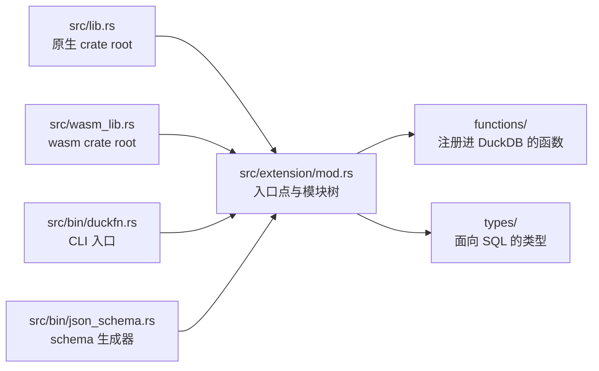

# 目录结构

```text
src/lib.rs             原生 crate root  ->  mod extension;
src/wasm_lib.rs        wasm crate root  ->  mod extension;   （同一组 mod，镜像）
src/extension/mod.rs   ->  duckfn_entrypoint!("duckfn_kuva"); + mod functions; mod types;
src/bin/duckfn.rs      duckfn CLI 入口  ->  #[path] mod extension; + duckfn::cli::run(...)
src/bin/json_schema.rs JSON Schema 生成器 ->  #[path] mod extension; + schemars
                       （只有打开 json-schema feature 才编，见下）

src/extension/functions/
    mod.rs             mod kuva_render; mod kuva_render_terminal; mod kuva_render_file; mod spec;
    kuva_render.rs     kuva_render(json[, data]) -> SVG：JSON 入口
    kuva_render_terminal.rs  同一段规格渲染成终端文本
    kuva_render_file.rs      同一段规格写成 SVG 文件（仅原生构建）
    spec/mod.rs        render_json：解析 JSON 并渲染
    spec/schema/       JSON 的 schema，一组 serde 类型（面板 / 外观 / series）
    spec/schema/series/  每种图型一个文件 —— kuva 的全部 64 种图型
    spec/convert/      spec -> kuva 的翻译（布局、枚举、每型一个 build 函数）
                       charts/ 与 spec/schema/series/ 一一对应；每个文件末尾都是内联的
                       `#[cfg(test)] mod tests`：JSON 进、SVG 出，并验证是合法 XML
                       （两个共用小工具在 spec/mod.rs）
src/extension/types/
    mod.rs             空的槽：面向 SQL 的类型放这一层（目前为空）

test/sql/                   SQLLogicTest 用例
sdk/json_schema/            生成出来的 JSON Schema：kuva_render 两个参数的形状
scripts/rename.sh           克隆后改扩展名
scripts/release.sh          提版本号、打 tag、切开发版本
Justfile                    日常命令
docs/                       这份文档站
community-extension/        社区扩展注册草稿
```

## 两个 crate root

`src/lib.rs` 与 `src/wasm_lib.rs` 都只声明一个模块 `mod extension;`，其余子模块由 `extension/mod.rs`
往下挂。官方 Rust 模板的写法是 `mod lib;` 再由 wasm 那个 root 转发一次，模块一嵌套就会
`error[E0583]: file not found for module …`：那等于同一组路径存了两份、要一直保持同步。

四个入口都编同一棵模块树 —— 两个 crate root 与两个 bin：



所以新增模块只需要动 `extension/mod.rs`（以及下一层的 `mod.rs`），永远不用改 crate root。

## 命令行工具

`src/bin/duckfn.rs` 用 `#[path = "../extension/mod.rs"] mod extension;` 把扩展再编一遍，然后调用
`duckfn::cli::run(...)`。它存在的意义是导出函数描述 CSV（`just docs_csv`），不参与扩展本体。

那里的 `#[path]` 不是省事的写法，而是必需的：`#[duck_*]` 的文档元数据靠 `inventory` 的静态构造器收集，
只有**真正被链接进最终二进制**的目标文件才会生效。写成 `use duckfn_kuva::…` 时，链接器可能把这些模块
整块丢掉，导出的 CSV 就会静默变空。

## JSON Schema 生成器

`src/bin/json_schema.rs`（`just json_schema`）把 `kuva_render(json, data_json)` 的两个参数渲染成
`sdk/json_schema/` 下的两个文件：

| 文件 | 描述的形状 | 真相源 |
| --- | --- | --- |
| `render.schema.json` | 第一个参数（图表配置） | `spec/schema/`，根类型 `RenderSpec` |
| `datasets.schema.json` | 第二个参数（数据集注册表） | `spec/dataset.rs`，类型 `Registry` |

[schemars](https://crates.io/crates/schemars) 直接读 Rust 的类型定义，`///` 文档注释自动变成 schema
里的 `description` —— 没有第二份手工维护的字段表，也没有 AI 现编的说明。改了类型（或改了注释），
重跑一遍命令、把 diff 一起提交。这两个文件是**产物**：不手改，刚跑完命令时 `git diff -- sdk/` 应为空。

这里的 `#[path]` 与 CLI bin 那边原因不同：schema 类型全是 `pub(crate)`，rlib 之外根本摸不到。

schemars 是挂在 `json-schema` feature 上的**可选依赖**（见 `Cargo.toml`），bin 上也带了
`required-features = ["json-schema"]`。所以默认的 `cargo build` —— 以及 wasm 产物 —— 连编都不会编它，
扩展本体不为一个只有工具链需要的依赖付成本。同一个机制还给 `spec/schema/` 下的每个类型加上
`#[cfg_attr(feature = "json-schema", derive(schemars::JsonSchema))]`：feature 关着时，扩展源码里
一行 schemars 代码都没有。

## 每种图型一个文件

`spec/schema/series/` 与 `spec/convert/charts/` 一一对应，两边都是**每种图型一个文件**。正是这一点
让补齐剩下的图型很便宜：每加一种就是「一个 `mod`、一个 `SeriesSpec` 变体、一个 `build_*`」，已有的
文件一个都不用动。各图型共用的部分 —— 外观字段、点、误差棒、趋势线、区间带 —— 都在
`series/common.rs` 里，所以没有哪个文件会随着图型数量一起变长。等某个文件真的到了几百行，再按形态
把它自己拆开。

文件名是 `boxplot.rs` 而不是 `box.rs`：`box` 是 Rust 关键字，`mod box;` 编不过。

## 依赖

`Cargo.toml` 里每个 crate 都写了一句它负责什么、为什么选它。决定构建形态的是这几个：

- **[duckfn](https://crates.io/crates/duckfn)** —— 把普通 Rust 函数注册进 DuckDB 的属性宏。只开了
  `cli` 这一个 feature（`src/bin/duckfn.rs` 要用）；刻意不开 `all`，因为它会一起打开 `duckdb-1-5`，
  也就是 DuckDB C API 的**不稳定区**（copy 函数、宿主 VFS、标量的 bind/init 槽位）。留在稳定区，
  才有一份二进制跨 DuckDB 版本通用。
- **[kuva](https://crates.io/crates/kuva)** —— 这个扩展要暴露的绘图库，**只用它的默认 feature 集**
  （是空的），也就是只有 SVG 后端：它的依赖只有 chrono、colorous、ryu，纯 Rust、可编到 wasm。
  `png` / `pdf` / `full` / `cli` / `parquet` 会带进 fontdue、png、krilla、arrow 之类（`pdf` 还要求
  Rust ≥ 1.92）；一个都没开。
- **[quick-xml](https://crates.io/crates/quick-xml)** —— **只作 dev-dependency**，单测用它确认渲染出的
  SVG 是合法 XML。它不会进扩展二进制。
- **[schemars](https://crates.io/crates/schemars)** —— **可选依赖**（`json-schema` feature）：把
  `spec/schema/` 里的类型渲染成 `sdk/json_schema/` 下的 JSON Schema。只有 `src/bin/json_schema.rs`
  编它；扩展本体与 wasm 产物完全看不到它。

[serde](https://crates.io/crates/serde) / [serde_json](https://crates.io/crates/serde_json) 是 JSON 入口的
地基：规格是被反序列化成有类型的 struct，而不是从 Map 里逐键读。
[quack-rs](https://crates.io/crates/quack-rs) 与
[libduckdb-sys](https://crates.io/crates/libduckdb-sys) 是宏展开直接引用的 DuckDB C API 绑定；
`libduckdb-sys` 只有头文件（`loadable-extension`），所以本地不需要编译 DuckDB。

## 命名规则

| 规则 | 为什么 |
| --- | --- |
| 扩展名全小写、只含下划线，且五处一致。 | 它既是入口点符号，也是产物文件名；DuckDB 是按文件名去找符号的。`just rename` 负责写全这五处。 |
| 每个注册进 SQL 的名字共用一个短前缀（这里是 `kuva_`）。 | DuckDB 没有命名空间，而社区扩展几乎都不把包名写进函数名。约定见 `AGENTS.md`。 |
| `src/lib.rs` 与 `src/wasm_lib.rs` 始终声明同一组 `mod`。 | 否则 wasm 构建编不出这棵模块树。 |
| 临时文件（脚本、数据、日志）放 `target/`。 | `target/` 已被 git 忽略，不会污染被跟踪的目录。 |
| 文本文件一律 LF。 | 仓库按 LF 入库，`.gitattributes` 的归一化依赖这一点。 |

## 开发笔记在哪

设计说明就在这份指南里：上面的模块结构、[写函数](./writing-functions.md)、[测试](./testing.md) 与
[构建与发布](./build-and-release.md)。`AGENTS.md` 里是仓库的约定、发版流程，以及一份「duckfn 自己的
文档按主题在哪儿」的对照表 —— 属性宏能做的所有事都在那边，不在本仓库里。

duckfn 0.0.11 起，那份指南连同**可运行的示例扩展**与它的 SQLLogicTest 用例都随 crate 一起发布，
所以它们始终与 `Cargo.toml` 里的版本一致，也不需要 clone duckfn 的 git 仓库：

```shell
# 跑过一次构建之后：cargo 实际编译的那份源码
ls -d ~/.cargo/registry/src/*/duckfn-*/
```

| 那个目录下的路径 | 是什么 |
| --- | --- |
| `docs/docs/**` | 用户指南正文（英文），含每类注册方式各一章。 |
| `docs/i18n/zh-Hans/…/current/**` | 同一份指南的简体中文版。 |
| `src/extension/**` | 示例扩展：每类注册方式一个文件，外加自定义类型与一个组合示例。 |
| `test/sql/**` | 示例的 SQLLogicTest 用例，抄结构用。 |

指南也有渲染好的在线版本 [shijianjs.github.io/duckfn/zh-Hans](https://shijianjs.github.io/duckfn/zh-Hans/)，
但它可能比你的依赖新；registry 里那份才是本项目实际编译的代码。
